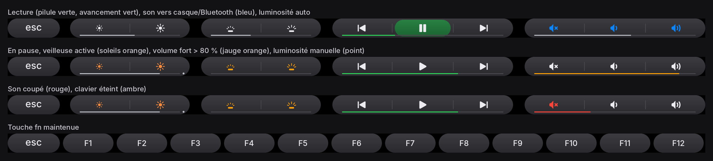

# MacBook Pro 13,3 (2016, Touch Bar) sous Linux

Tout ce qu'il a fallu pour faire tourner un MacBook Pro 2016 à Touch Bar sous
Linux : Touch Bar, caméra FaceTime HD, Touch ID, Wi-Fi, son, écran amdgpu…

Le cœur du problème est la **T1**, le coprocesseur Apple qui pilote la Touch
Bar, la caméra, le rétroéclairage clavier et le Touch ID. Sous Linux, il
apparaît comme un iBridge USB (`05ac:8600`) qu'il faut « réveiller » et
configurer (projet [t1bridge](https://github.com/standardagents/t1bridge)).

| Distribution | État | Dossier |
|---|---|---|
| **Debian 13 (trixie)**, GNOME 48 / Wayland | ✅ **version suivie**, la plus complète | [`debian13/`](debian13/README.md) |
| Fedora 44 | archive (Touch Bar, caméra, clavier, écran) | [`fedora44/`](fedora44/README.md) |

## Machine

| | |
|---|---|
| Modèle | MacBookPro13,3 (2016, Touch Bar) |
| CPU | i7-6820HQ (Skylake) |
| GPU | Intel HD 530 (i915) + AMD Baffin/Polaris (RX 550, amdgpu), écran eDP piloté par **amdgpu via GMUX** |
| Disque | LUKS (+ LVM sous Debian) |

## Debian 13 : statut

| Chantier | Statut | Dossier |
|---|---|---|
| **Wi-Fi** BCM43602 (5 GHz, signal) | ✅ -55 dBm en 5 GHz (contre -89 dBm en 2,4 GHz avant) | [`wifi/`](debian13/wifi/) |
| **Son** CS8409 (haut-parleurs + micro interne) | ✅ — ❌ micro du casque jack non pris en charge | [`son/`](debian13/son/) |
| **T1 en recovery** (`05ac:1281`) | ✅ régénérée avec t1-revive | [`t1-revive/`](debian13/README.md#t1-revive-t1-bloquée-en-recovery) |
| **Touch Bar** | ✅ (t1bridge, modules portés en 6.12), allumée dès l'écran de connexion | [`touchbar/`](debian13/touchbar/) |
| **Caméra** FaceTime HD | ✅ caméra virtuelle à la demande (Meet, Firefox, GNOME Caméra) | [`camera/`](debian13/camera/) |
| **Écran noir / gel** (amdgpu Polaris) | ✅ niveau DPM fixe (`high`, ou `low` en économie d'énergie) |
| **Profils d'énergie** (CPU, turbo, secteur) | ✅ économie 1200 MHz, équilibré sans turbo, performance turbo ; secteur → équilibré | [`display/`](debian13/README.md#écran-noir--gel--amdgpu-polaris) |
| **Clavier** `@` / `<` inversés | ✅ `applespi iso_layout=1` | [`fedora44/keyboard/`](fedora44/keyboard/README.md) |
| **Touch ID** (sudo, polkit, verrouillage, GDM) | ✅ 2 doigts, 3 essais avant le mot de passe, Touch Bar en français | [`touchid/`](debian13/README.md#touch-id) |
| **Touch Bar : volume / média** | ✅ fournisseur bureau GNOME + PipeWire, jauges dans la Touch Bar | [`touchbar/desktop-provider/`](debian13/README.md#touch-bar--volume-sourdine-média) |
| **Touch Bar : look** | ✅ touches en capsules, icônes vectorielles, jauges, couleurs d'état | [`touchbar/`](debian13/README.md#touch-bar--style-capsules-et-jauges) |
| **Capteur de lumière ambiante** | ✅ déjà fonctionnel (luminosité auto GNOME) | [détails](debian13/README.md#capteur-de-lumière-ambiante) |
| **Modules T1 sous DKMS** | ✅ reconstruits à chaque nouveau kernel | [`dkms/`](debian13/README.md#après-une-mise-à-jour-du-kernel--dkms) |
| **Thunderbolt 3 : USB 3 des écrans** (Ethernet) | ✅ runtime PM désactivé sur les contrôleurs USB 3 Alpine Ridge | [détails](debian13/README.md#thunderbolt-3--usb-3-des-écrans--docks-perdu-ethernet-etc) |
| **Écran de démarrage** (LUKS) | ✅ pomme blanche sur fond noir, saisie façon macOS (Plymouth) | [`demarrage/`](debian13/README.md#écran-de-démarrage--pomme--plymouth) |
| Veille / hibernation | ❌ impossible : la Radeon Polaris ne se réveille pas → **interdites** au niveau système | [`veille/`](debian13/README.md#veille-et-hibernation--impossibles-amdgpu) |

## Touch Bar



Touches en capsules, jauges, avancement du morceau et couleurs d'état (lecture,
muet, casque/Bluetooth, veilleuse…) : rendu maison par un
[patch de t1bridge](debian13/touchbar/patches/t1bridge-touchbar-capsules-jauges.patch),
détails dans [`debian13/README.md`](debian13/README.md#touch-bar--style-capsules-et-jauges).

## Organisation du dépôt

```
debian13/   ← installation Debian 13 : un dossier par chantier (wifi, son, touchbar, touchid…)
fedora44/   ← première installation sous Fedora 44 (archive)
```
